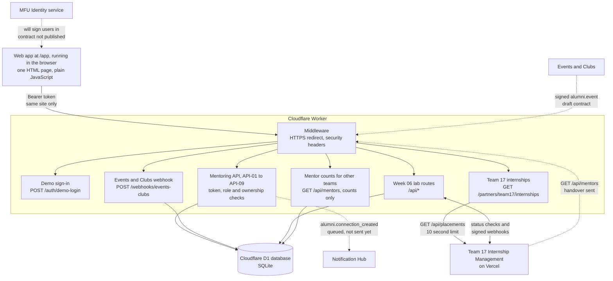
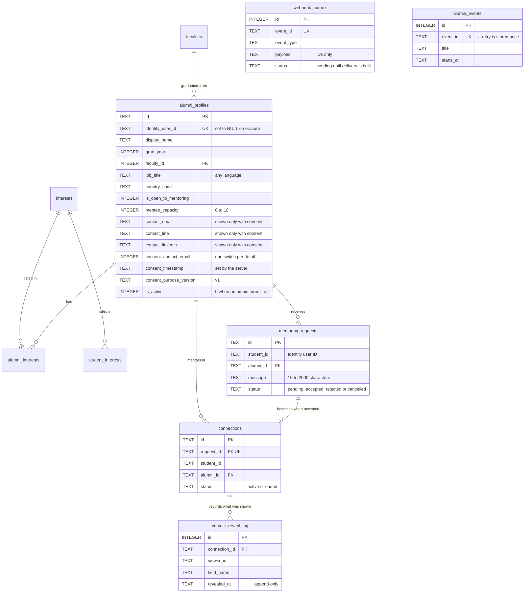
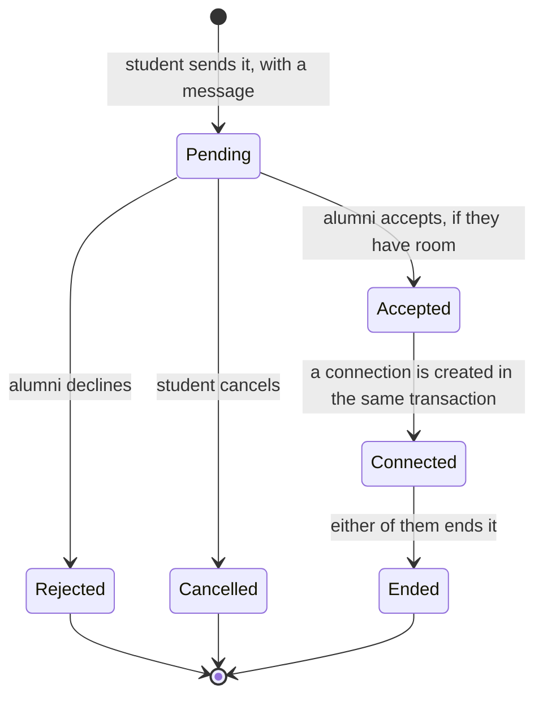
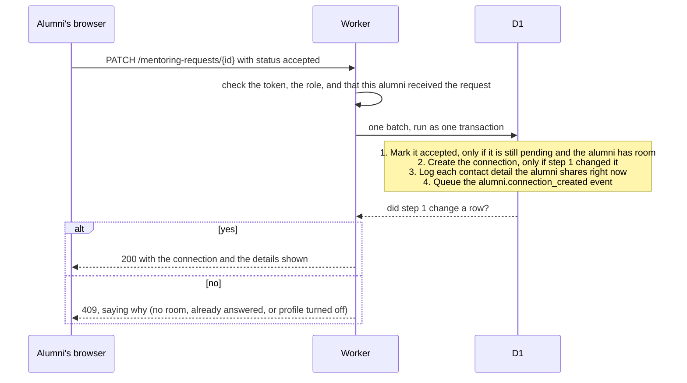

# Architecture

How the MFU Alumni Network is built: the parts, how they talk to each other, where each one is in
the code, and why it's built this way. The diagrams render on GitHub.

## The system

Solid lines work today. Dashed lines are planned in the PRD and wait on another team or on work we
haven't done yet. The Worker is written in TypeScript with the Hono framework. A PNG of this diagram,
for slides, is in [`evidence/architecture.png`](evidence/architecture.png).

**One Worker serves everything:** the web app, the API, the docs page at `/docs` and the Week 06 lab
routes, all at <https://alumni-network-integration.phyo2lay.workers.dev>. The web app only calls its
own site, so it needs no CORS, and its Content-Security-Policy allows nothing else. The browser
never talks to Team 17 directly: our Worker calls them and checks their answer first.

## Where to start reading

| File | What it does | PRD |
|---|---|---|
| [`src/index.ts`](src/index.ts) | The entry point: security middleware, the `/app` and `/docs` pages, the Week 06 lab routes, and the mount point for every other route | |
| [`src/lib/auth.ts`](src/lib/auth.ts) | Checks the token and the caller's role on every protected route | NFR-02 |
| [`src/lib/validate.ts`](src/lib/validate.ts), [`errors.ts`](src/lib/errors.ts) | Turns bad input into `400` with a message per field, and gives every error one JSON shape | |
| [`src/lib/hmac.ts`](src/lib/hmac.ts) | Signs webhook bodies and compares signatures in constant time | FR-11 |
| [`src/routes/alumni.ts`](src/routes/alumni.ts) | Search, the three profile views, and creating or editing a profile with its consent switches | FR-01 to FR-03, BR-01, BR-02, BR-10 |
| [`src/routes/requests.ts`](src/routes/requests.ts) | Sending, listing and answering mentoring requests, including the accept transaction | FR-04 to FR-07, BR-05, BR-08 |
| [`src/routes/connections.ts`](src/routes/connections.ts) | Ending a connection | FR-08 |
| [`src/routes/admin.ts`](src/routes/admin.ts) | Turning off a profile | API-08 |
| [`src/routes/events-clubs.ts`](src/routes/events-clubs.ts) | Receiving signed alumni events from Events and Clubs | FR-11 |
| [`src/routes/demo-auth.ts`](src/routes/demo-auth.ts) | Demo sign-in, until MFU Identity publishes its tokens | Assumption 1 |
| [`src/routes/partner-internships.ts`](src/routes/partner-internships.ts) | Team 17's open internships, checked and linked to our mentors | Integration |
| [`src/routes/partner-mentors.ts`](src/routes/partner-mentors.ts) | Public mentor counts by field, for Team 17's internship pages. See the [handover](handover/README.md) | Integration |
| [`src/app.html`](src/app.html) | The web app: sign-in, find a mentor, profile and request, requests, my profile, internships | NFR-07 |
| [`src/app-ui-helpers.ts`](src/app-ui-helpers.ts) | The web app's shared helpers for building the page from text nodes, put into `/app` by [`index.ts`](src/index.ts) | NFR-07 |
| [`src/docs.html`](src/docs.html) | API reference, with a console for trying every route | Section 11 |
| [`migrations/0002_alumni_network.sql`](migrations/0002_alumni_network.sql) | The database: tables, rules, triggers and the faculty and interest lists | Section 8 |
| [`migrations/0003_current_mfu_schools.sql`](migrations/0003_current_mfu_schools.sql) | Brings the schools up to MFU's current 15: the PRD's 11 had an old name and four missing | Section 8 |
| [`test/`](test/) | 346 tests, run inside the Workers runtime against a real D1 database. See [TESTING.md](TESTING.md) | Test plan |
| [`scripts/`](scripts/) | The live demo, seed data, and the Team 17 and security evidence runs | |

## The data

Students have no table of their own. They exist as Identity user IDs on their requests and
connections. The Week 06 lab adds two more tables, `webhook_events` and `idempotency_keys`
([`0001_init.sql`](migrations/0001_init.sql)).

The table and column names match the team's Data and Query Design (Week 04, a group document
outside this repo), ported from PostgreSQL to SQLite. SQLite has no enum types, so status columns
use CHECK rules instead.

## A request's life

- A student can have **one** pending request to each alumni (BR-05) and **five** in total (BR-08).
- Only a pending request can change. Any other change answers `409`.
- Contact details are visible only while the connection is active, and only the ones the alumni
  shares right now.

### Accepting a request

This is the one place where two people acting at the same moment could break a rule, so it's built
with care:

D1 can't lock rows, which the data design relied on. Step 1 checks the room left and changes the
status in one SQL statement, so nothing can land between the check and the change. A test fires
many accepts at once and checks that capacity always holds
([`requests.test.ts`](test/requests.test.ts#L397)).

## Design decisions

| Decision | Why | What it costs |
|---|---|---|
| **Cloudflare Workers and D1, not the PRD's Next.js, Vercel and Supabase** | The Week 06 integration with Team 17 was already live on Workers and D1 in September. The free plan never pauses, while the PRD needed a scheduled pinger to keep free Supabase awake (NFR-03). One deploy serves the API, the web app and the docs | D1 has no row locks (see the next row). The PRD and data design describe the other stack |
| **Limits checked in one SQL statement, not with row locks** | SQLite has no `SELECT … FOR UPDATE` | The SQL is harder to read. Race tests prove it holds |
| **Contact details filtered in SQL** | `PUBLIC_COLUMNS` never selects contact or consent columns, so they can't leak by accident | Every new view needs its own query |
| **Consent checked on every view, not copied at accept** | Taking consent back works straight away, even inside a connection (BR-03) | One more query when a connected student opens a profile |
| **The web app is one HTML page with plain JavaScript, served by the same Worker** | No build step, same site so no CORS, and a strict Content-Security-Policy is possible | About 1,200 lines in one file, with no framework to organise them |
| **Demo sign-in until MFU Identity publishes its tokens** | The browser must never hold `JWT_SECRET`, and Identity hasn't published its contract (PRD Assumption 1) | Anyone can sign in as any demo person, with no password, so the live demo data can be changed by visitors (`npm run demo:reset` restores it). Demo tokens only reach `demo-` IDs and demo claims. Only [`auth.ts`](src/lib/auth.ts) changes when Identity arrives |
| **Our Worker calls Team 17, not the browser** | Keeps the page's policy at "this site only", and checks every listing before students see it | One more hop. Team 17 can take about 3 seconds to start up |
| **Other teams get counts, not profiles** | Team 17 only needs to know whether mentors exist in a field. Names and contact details stay behind MFU sign-in and consent | They can't show who the mentors are. Students follow the link to our app for that |
| **Events queued in the same transaction as the accept** | If sending fails later, the event isn't lost (the outbox pattern) | Sending isn't built yet, so events wait in the table |

## Built and planned

Against the PRD's "MVP is complete when" list (section 17):

| PRD criterion | Status |
|---|---|
| Search with all five filters, including Burmese and Thai text, respecting consent | ✅ Built |
| Alumni manage their profile, consent, availability and capacity. Unknown fields are refused | ✅ Built |
| Request, accept, connection and contact shown, with the reveal logged | ✅ Built |
| Duplicate and over-capacity requests refused under concurrent load (test 8) | ✅ Built |
| Invalid state changes answer `409` | ✅ Built |
| Taking consent back stops all later display | ✅ Built |
| Erasure anonymises the account and allows registering again | ❌ Not built (BR-04) |
| AI suggestions within 5 seconds, with a rule-based fallback | ❌ Not built (FR-09) |
| `alumni.connection_created` reaches the Notification Hub through the outbox | ⚠️ Queued, not sent (FR-10). Forged inbound webhooks are refused ✅ |
| Alumni events from Events and Clubs appear for matching students | ⚠️ Received, checked and stored. Not shown to students yet (FR-11) |
| All 11 planned tests pass | ⚠️ 10 fully and test 6 half (sending isn't built), out of 346 tests. Run before each deploy, not in CI |
| Deployed at 0 THB, with runbooks | ✅ Deployed on Cloudflare's free plan. ❌ No runbooks |

Also not built: the OpenAPI document (the `/docs` page covers every route instead), and real Identity
tokens.

**Alumni after graduation (PRD Assumption 1):** the fallback is built as an API, without screens in
the web app yet. An alumni whose student email has closed sends a claim with a personal email
(`POST /auth/alumni/register`, student addresses refused). An admin, standing in for the Alumni
Association, approves it (`/admin/alumni-verifications`). The alumni then signs in with a single-use,
15-minute code sent to that email ([`alumni-verification.ts`](src/routes/alumni-verification.ts),
[migration 0004](migrations/0004_alumni_email_fallback.sql)). No email provider is connected, so only
demo claims, with a reserved `@example.com` email, can sign in for now: their code comes back in the
answer. A demo admin sees and reviews demo claims only.

## Deployment

| | |
|---|---|
| Live URL | <https://alumni-network-integration.phyo2lay.workers.dev> |
| Hosting | Cloudflare Workers, free plan |
| Database | Cloudflare D1 `alumni-network-db`. Migrations in [`migrations/`](migrations/) |
| Settings | [`wrangler.jsonc`](wrangler.jsonc): Team 17's URLs and our team name. Not secret |
| Secrets | `JWT_SECRET`, `EVENTS_CLUBS_WEBHOOK_SECRET`, `WEBHOOK_SECRET` and `PARTNER_WEBHOOK_SECRET`, as Cloudflare Worker secrets |
| Logs | Cloudflare Workers observability. Each Team 17 call is logged with its request ID |
| Deploy | `npm test`, then `npm run deploy`, then `npm run demo` to check the live site end to end |
