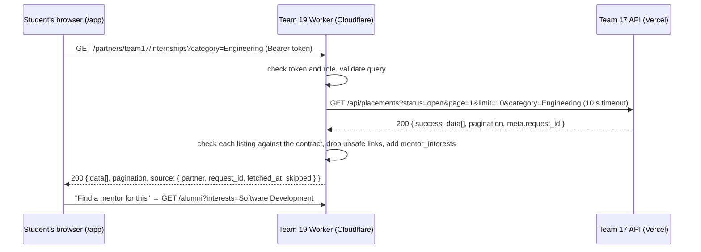

# Integration evidence: Team 19 Alumni Network → Team 17 Internship Management

Team 19 (Alumni Network) consumes Team 17's public **Internship Opportunities API**, contract 1.0.
Both teams are in Pod 5. Team 17 is our only integration partner.

**What it does for users:** students open the **Internships** tab, see Team 17's live open
internships, and press **Find a mentor for this** to search our directory for alumni who do that kind
of work. The deck lists an internship board as out of scope for our own product, so we use Team 17's
instead of building one.

## The contract we use

| | |
|---|---|
| Provider | Team 17 Internship Management, <https://team17-internship.vercel.app> |
| Endpoint | `GET /api/placements` (list), with `status`, `page`, `limit`, `q`, `category` and `work_mode` |
| Authentication | None. It's a public, read-only API |
| Source | `Team17-Team12-API-Handover/` (README, OpenAPI 3.1 file, Postman collection) |

## How the call flows



The browser only ever talks to our Worker. That keeps our page's Content-Security-Policy at
`connect-src 'self'`, and every listing is checked before a student sees it.

## Source code

| File | What it shows |
|---|---|
| [`src/routes/partner-internships.ts`](../src/routes/partner-internships.ts) | The API call: filters forwarded, timeout, contract checks, link safety, category mapping, error codes |
| [`src/app.html`](../src/app.html) (`internshipsView`) | The Internships tab and Find a mentor for this |
| [`test/partner-internships.test.ts`](../test/partner-internships.test.ts) | 24 tests against a fake Team 17. They never call the real one |
| [`scripts/team17-evidence.mjs`](../scripts/team17-evidence.mjs) | `npm run evidence:team17`: one live call, printed with Team 17's request ID |
| [`wrangler.jsonc`](../wrangler.jsonc) | `PARTNER_PLACEMENTS_URL` (a setting, not a secret) |

## Live request and response

Captured on 9 November 2026 against the deployed Worker. Full output:
[`team17-internships-live-call.txt`](team17-internships-live-call.txt).

```text
GET https://alumni-network-integration.phyo2lay.workers.dev/partners/team17/internships?category=Engineering&limit=5
  as student demo-student-su-myat, at 2026-11-09T07:13:43.789Z

200 in 1430 ms
  • Frontend Developer Intern, Sample Web Lab (remote) → mentor interests: Software Development
  • Software Engineering Intern, Sample Systems (hybrid) → mentor interests: Software Development

source {"partner":"Team 17 Internship Management","request_id":"a461ec05-1277-4b26-a79a-ed2b280d8ed7","fetched_at":"2026-11-09T07:13:44.748Z","skipped":0}
```

Team 17 request ID **`a461ec05-1277-4b26-a79a-ed2b280d8ed7`**. Team 17 can find this request in
their logs.

The Worker also logs each call to Team 17 (Cloudflare Workers observability), for example:

```json
{"partner":"team17","path":"/api/placements?status=open&page=1&limit=10","status":200,"request_id":"f49ee089-95de-4c09-a286-ebb35efd625c","ms":3196}
```

## Screenshots

- [`team17-internships-live.png`](team17-internships-live.png): the Internships tab on the live site,
  with all six of Team 17's listings and their request ID at the bottom.
- [`team17-find-a-mentor-live.png`](team17-find-a-mentor-live.png): Find a mentor for this on the
  Frontend Developer internship, which opens our directory filtered to Software Development.

## When Team 17 misbehaves

Following step 8 of their handover, each failure gets a clear answer, and the web app shows a message
with **Try again**:

| What happens | We answer | Tested by |
|---|---|---|
| Team 17 returns 503 | 503 `PARTNER_UNAVAILABLE` | `answers 503 when Team 17 says it is unavailable` |
| Network failure | 503 `PARTNER_UNAVAILABLE` | `answers 503 when Team 17 cannot be reached` |
| No answer in 10 seconds | 504 `PARTNER_TIMEOUT` | `answers 504 when Team 17 is too slow` |
| Team 17 returns another error | 502 `PARTNER_ERROR` | `answers 502 when Team 17 returns another error` |
| Not JSON, or the wrong shape | 502 `PARTNER_BAD_RESPONSE` | `answers 502 when the response is …` (3 cases) |
| One listing breaks the contract | That listing is skipped and counted in `source.skipped` | `skips a listing that breaks the contract` |
| A link points off Team 17's https site | `details_url: null` | `drops a details link to …` (3 cases) |
| Our query is invalid | 400, and Team 17 isn't called | `rejects … without calling Team 17` (4 cases) |

## Earlier integration with Team 17 (A5, Week 06)

These routes are still live:

- `GET /api/partner/status`: we call Team 17's status endpoint.
- `GET /api/integration/status`: Team 17 calls ours.
- `POST /api/webhooks/send-test`: we send a webhook to their receiver with their shared secret.
- `POST /api/webhooks/partner`: we receive HMAC-signed webhooks.

Evidence is in [`../A5-Team19-Integration-Evidence.md`](../A5-Team19-Integration-Evidence.md).
